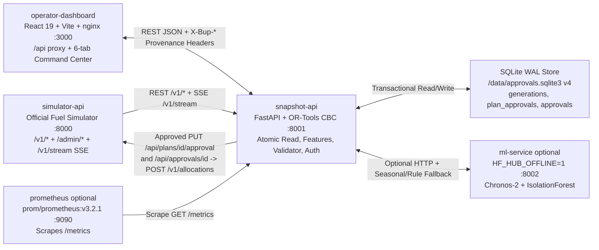

# BUP Fuel Supply Operations — System Architecture

## 1. End-to-End Architecture Diagram

## 2. Container & Service Topology

| Service | Container / Port | Role | Fail-Safe / Offline Behavior |
| --- | --- | --- | --- |
| `simulator-api` | `asifmahmoud414/bup-fuel-supply-simulator:1.0.0` (`8000`) | Unmodified authoritative discrete-tick fuel simulator (`/v1/*`, `/admin/*`, `/v1/stream`). | Authoritative source of truth; read atomically (`before == after` instance check). |
| `snapshot-api` | FastAPI + OR-Tools CBC ([backend/Dockerfile](../backend/Dockerfile), `8001`) | API gateway, SQLite WAL state/generation ledger, causal feature extraction, shortage projection, OR-Tools optimizer, safety fallback, auth, Prometheus metrics. | Continues serving with `SEASONAL` + `RULE` + `SAFE_REORDER` even if `ml-service` is down; falls back cleanly to curated [evidence/](evidence/) when `artifacts/` is absent. |
| `operator-dashboard` | React 19 + Vite + nginx ([frontend/Dockerfile](../frontend/Dockerfile), `3000`) | Operator UI, nginx `/api` proxy, health/SSE banner, network schematic, forecast explorer, shortage/incident ledgers, optimization preview & joint approval workflow. | Retries API cleanly; marks UI stale on SSE disconnect/upstream outage, distinguishes simulator `sim_time` from client HTTP receipt time, and restores active backend plans across page reloads. |
| `ml-service` *(optional `ml` profile)* | FastAPI ([ml-service/Dockerfile](../ml-service/Dockerfile), `8002`) | Local offline `amazon/chronos-2` (`HF_HUB_OFFLINE=1`) + `iforest-bup-v1.0.0` anomaly scorer. | `/health/ready` returns `200` only when both models load (else `503`); core backend continues uninterrupted when stopped. |
| `prometheus` *(optional `monitoring` profile)* | `prom/prometheus:v3.2.1` (`9090`) | Scrapes `/metrics` on `snapshot-api` via [monitoring/prometheus.yml](../monitoring/prometheus.yml). | Bounded label-cardinality metrics isolated in custom `CollectorRegistry`. |

---

## 3. Backend Module Layout (`backend/`)

- [main.py](../backend/main.py): Lifespan orchestration, SSE watcher with exponential reconnect backoff and generation reset detection (`simulator.notice`), single-flight planning coalescing (`_get_planning_coalesced`), `RUNNING` coherent grace cache (`RUNNING_COHERENT_GRACE_SECONDS`, default `15.0 s`), provenance headers (`X-Bup-As-Of-Tick`, `X-Bup-Current-Tick`, `X-Bup-Age-Ticks`, `X-Bup-Observed-At`, `X-Bup-Cached`, `X-Bup-Degraded`), circuit breaker (`THRESHOLD=5`, `COOLDOWN=3.0s`), security headers (`X-Content-Type-Options`, `X-Frame-Options`, `Referrer-Policy`), and REST endpoints (`/api/*`, `/metrics`).
- [storage.py](../backend/storage.py): Versioned SQLite WAL store (`SCHEMA_VERSION = 4`, `busy_timeout=5000`) across `generations`, `approvals`, `plan_approvals`, `plan_approval_items` (deterministic UUID5 `intent_id`s), `demand_observations`, `snapshot_history`, `forecast_runs`, `forecast_points` (with matured-actual backfill), `incidents` (2-tick clear hysteresis debounce), immutable `plans` (retention-protected when referenced by approvals), and `evaluation_runs`.
- [approvals.py](../backend/approvals.py): Backend-owned idempotent joint batch executor (`execute_plan_approval`, `reconcile_plan_approval_view`) and single-shipment ledger (`ApprovalStore`), enforcing fresh simulator validation + `generation_id` verification before persistence, timeout-after-commit recovery, halts on partial/rejected items with `requires_new_plan=True`, `409` blocks across reset boundaries and payload mismatches, and `PENDING` cancellation via `POST /v1/allocations/{id}/cancel`.
- [planning.py](../backend/planning.py): Orchestrates observation indexing, incoming in-transit/pending supply extraction, seasonal/ML forecasting, OR-Tools optimization (including optional `max_recommendations` and `max_total_liters` budget limits), shortage detail building, and hybrid anomaly merging.
- `intelligence/`:
  - [contracts.py](../backend/intelligence/contracts.py): Strict Pydantic schemas and version constants (`FEATURE_SCHEMA_VERSION = "v1.0.0"`).
  - [collector.py](../backend/intelligence/collector.py): Regularized grid alignment, gap detection, duplicate/future tick rejection, and official diurnal profile curve helpers.
  - [features.py](../backend/intelligence/features.py): Strict leak-free historical normalization and causal horizon covariates.
  - [forecasting.py](../backend/intelligence/forecasting.py): Rolling historical baseline + seasonal de-seasonalized projection with sigma uncertainty intervals.
  - [shortage.py](../backend/intelligence/shortage.py): Tick-by-tick inventory projection distinguishing station outages from fuel depletion, lead-time + cadence safety stock calculation, and heuristic shortage classification.
  - [optimizer.py](../backend/intelligence/optimizer.py): OR-Tools `CBC` constrained Mixed-Integer Linear Program (`optimize_allocations`), counterfactual joint simulator (`simulate_joint_impact`), and independent post-solve invariant checker (`validate_plan_independently`).
  - [fallback.py](../backend/intelligence/fallback.py): Safe constrained safety-stock reorder fallback & cold-start profile rate estimator.
  - [anomaly.py](../backend/intelligence/anomaly.py): Deterministic rules for all 6 simulator domain events merged cleanly with Isolation Forest outputs.
  - [explain.py](../backend/intelligence/explain.py): Structured rationale, telemetry signal list, and active constraint descriptions.
  - [evaluation.py](../backend/intelligence/evaluation.py): Read-only loader prioritizing runtime `artifacts/evaluation/` & `artifacts/load/`, falling back cleanly to curated [evidence/](evidence/), and returning `status: "not_yet_measured"` whenever neither holds measured results.
- [security.py](../backend/security.py) & [observability.py](../backend/observability.py): Opt-in PBKDF2-HMAC-SHA256 / Bearer operator authorization (`OPERATOR_AUTH_MODE`), request timing ring buffer, and Prometheus registry.

---

## 4. Verified Simulator Semantics & Safety Invariants

Empirically verified directly against `asifmahmoud414/bup-fuel-supply-simulator:1.0.0`:
1. **Atomic Snapshot Reads & Running Provenance:** `GET /v1/instance` checked before and after fan-out (`depots`, `stations`, `routes`, `regions`, `allocations`, `supply-arrivals`, `events`, `metrics`, `demand-history`); retries up to 3x on mid-read tick boundary mismatch and either serves a coherent snapshot bounded by `RUNNING_COHERENT_GRACE_SECONDS` (`15.0 s`) clearly marked `cached=true`, `degraded=true`, `age_ticks > 0` during `RUNNING`, or trips HTTP `503` when paused/stale/expired rather than serving torn world state.
2. **Immediate vs Arrival Accounting:** Official simulator deducts depot inventory immediately on `PENDING` creation, enforces `created_tick == tick` for depot dispatch capacity, checks immediate `station.inventory[fuel] + quantity <= station.capacity[fuel]` at approval time, does not refund depot stock if a route is disrupted at departure (`FAILED`), and does refund depot stock + dispatch capacity if canceled while `PENDING`.
3. **Human-in-the-Loop Execution Gate:** Zero endpoints auto-submit shipments. Joint batches (`PUT /api/plans/{plan_id}/approval`) and single dispatches (`PUT /api/approvals/{intent_id}`) require explicit operator action (and authorization when enabled), fresh feasibility validation, backend-generated idempotent UUIDs, and current `generation_id`.
