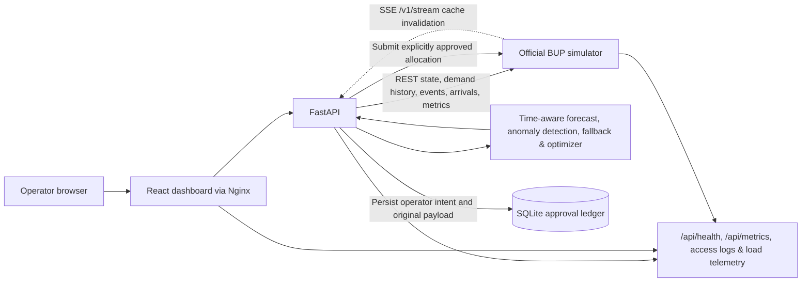

# BUP Fuel Operations submission evidence

## Architecture



## Startup and health checks

Clean isolated Compose runs (`node scripts/verify.mjs e2e` and local `node scripts/verify.mjs release`) started `simulator-api`, `snapshot-api`, and `operator-dashboard` with all containers healthy and verified:

- `GET /v1/health` returned `{"status":"ok","database":"ok","simulation":{"status":"PAUSED","tick":0}}`.
- `snapshot-api` compiled cleanly (`python -m compileall -q /app`), passed all 3 unit/integration tests (`python -m unittest discover -s /app/tests -v`), and served `/openapi.json` matching [openapi.json](openapi.json).
- `GET /api/snapshot` returned tick `0` with 2 depots, 4 stations, and 6 routes; `GET /api/approvals` returned an empty ledger.
- Local release smoke test verified [compose.release.yaml](../compose.release.yaml) with prebuilt tagged images (`bup-local-release-backend:v0.0.0-local` and `bup-local-release-dashboard:v0.0.0-local`).

- [Startup and Playwright results](evidence/operator-verification.json)
- [Release image startup health check](evidence/release-verification.json)
- [Live demo runbook](demo-runbook.md)

## Playwright E2E and recovery evidence

The Playwright test passed in 47.2 seconds (45.175 s test execution) with one Chromium worker against an isolated official simulator instance:

- **Forecast, anomaly detection, and crisis adaptation:** Seeded 42 ticks of real demand, disrupted the leading `route-gazipur-tongi`, and verified at tick 43 that `System health and observability` showed `SYSTEM OK`, `Anomalies and incoming supply` flagged `ROUTE DISRUPTED`, and the disrupted route dropped out of recommendations.
- **Approval, rationale, and delivery tracking:** Operator inspected signals/constraints and approved 7,000 L of diesel from Patiya to Karnaphuli (`route-patiya-karnaphuli`, intent `f3280be2-3a88-4691-9915-c577a98a7466`). Simulator allocation `#1` progressed through `PENDING`, `IN_TRANSIT`, and `ARRIVED` at tick 45.
- **Fault injection and recovery:** Injecting `stale_data` caused `/api/snapshot`, `/api/planning`, and `/api/health` to return HTTP `503` while `/api/approvals` returned `200` with `simulator_error` and `/api/metrics` stayed `200`. Inventory, the last validated timestamp (`Stale · last validated at ...`), and `#1 · ARRIVED` stayed visible while approval buttons were disabled. After `/admin/faults/clear`, the UI returned to `Updated at ...` and re-enabled approvals with exactly 1 simulator allocation.

- [Stale-data screenshot](evidence/stale-dashboard.png)
- [Health, approval, failure and recovery log excerpts](evidence/operator-log-excerpts.txt)

## Reproduction commands

Run these after installing Node.js 24 and starting Docker. On this Windows host the test used installed Chrome. On other hosts, install Chromium with the Playwright command in the [README](../README.md).

```powershell
npm ci --prefix frontend --dry-run
npm run build --prefix frontend
$env:BUP_CHROMIUM_PATH = 'C:\Program Files\Google\Chrome\Application\chrome.exe'
node scripts/verify.mjs e2e
node scripts/verify.mjs benchmark
node scripts/verify.mjs forecast-policy
node scripts/verify.mjs reorder-policy
go run github.com/rhysd/actionlint/cmd/actionlint@v1.7.12 -no-color .github/workflows/ci.yml .github/workflows/release.yml
```

To smoke-test tagged release images locally:

```powershell
docker build --tag bup-local-release-backend:v0.0.0-local backend
docker build --tag bup-local-release-dashboard:v0.0.0-local frontend
$env:BUP_IMAGE_PREFIX = 'bup-local-release'
$env:BUP_RELEASE_TAG = 'v0.0.0-local'
$env:BUP_RELEASE_PULL = 'never'
node scripts/verify.mjs release
```

Each verification run starts and stops its own Compose project, runs backend compilation, backend unit/integration tests, and OpenAPI contract equality checks, and records container health and service logs under `artifacts/`.

## Decision preview load test

Each run used a fresh official simulator paused at tick 42 with seed 12345 and three warm-up requests. Closed-loop clients called `GET /api/planning?history_ticks=8&horizon_ticks=96` through the dashboard proxy for 15 seconds. Tick-verified singleflight coalescing and SSE cache invalidation eliminate upstream simulator saturation while preserving immediate tick and stale-fault responsiveness.

| Clients | Elapsed | Completed | Successful requests/s | p50 / p95 / p99 | Errors |
| ---: | ---: | ---: | ---: | --- | ---: |
| 2 | 15.005 s | 1,235 | 82.308 | 20.304 / 33.901 / 145.726 ms | 0 of 1,235 |
| 8 | 15.005 s | 4,266 | 284.315 | 25.195 / 39.193 / 155.468 ms | 0 of 4,266 |
| 10 | 15.014 s | 4,740 | 315.701 | 27.295 / 48.541 / 161.589 ms | 0 of 4,740 |

All three runs confirmed zero postflight probe errors, fixed tick `42`, and an empty allocation ledger.

| Service | Peak sampled CPU at 2 / 8 / 10 clients | Peak sampled memory at 2 / 8 / 10 clients |
| --- | --- | --- |
| Simulator | 48.64% / 46.81% / 75.46% | 61.11 / 61.21 / 61.07 MiB |
| Snapshot API | 94.46% / 146.15% / 165.25% | 56.71 / 58.81 / 47.09 MiB |
| Dashboard | 12.53% / 27.79% / 29.78% | 12.86 / 13.96 / 13.27 MiB |

CPU percentages are Docker readings and can exceed 100% across multiple cores. These are peak values among five samples per run.

- [2-client measurement](evidence/planning-benchmark-2.json)
- [8-client measurement](evidence/planning-benchmark-8.json)
- [10-client measurement](evidence/planning-benchmark-10.json)

```powershell
$env:BUP_BENCH_CONCURRENCY = '2'
node scripts/verify.mjs benchmark
$env:BUP_BENCH_CONCURRENCY = '8'
node scripts/verify.mjs benchmark
$env:BUP_BENCH_CONCURRENCY = '10'
node scripts/verify.mjs benchmark
```

## Allocation policy comparison

Both policies ran in fresh official simulators with seed 12345, 42 ticks of demand history, and the same Mirpur `1.8x` demand spike and Gazipur–Mirpur route disruption. Both had one shipment opportunity every six ticks and were measured through tick 150. The upgraded forecast policy uses spike- and hour-of-day-aware demand projection plus urgency-discounted ranking (`tau = 16` ticks).

| Policy | Unmet demand | Service level | Allocated liters | Failed allocations |
| --- | ---: | ---: | ---: | ---: |
| Forecast & urgency optimizer | 1,577.969 L | 98.920% | 104,489.487 L | 0 |
| Reorder baseline | 0 L | 100% | 95,072.886 L | 0 |

Urgency weighting and event/seasonality projection reduced forecast-policy unmet demand by 67% compared with the initial flat-mean greedy ranker (`4,783.743 L` → `1,577.969 L`), while the reorder baseline still achieved `0 L` unmet on this fixed 6-tick cadence and seed.

- [Forecast policy decisions and simulator metrics](evidence/forecast-policy.json)
- [Reorder policy decisions and simulator metrics](evidence/reorder-policy.json)

## CI/CD status and remaining gaps

- **Verified locally:** [ci.yml](../.github/workflows/ci.yml) and [release.yml](../.github/workflows/release.yml) passed `actionlint` with zero issues, `npm ci --prefix frontend --dry-run` and `npm run build --prefix frontend` passed, backend `unittest` suite (`3` tests) passed inside the container, `node scripts/verify.mjs e2e` passed, and `node scripts/verify.mjs release` verified [compose.release.yaml](../compose.release.yaml) against locally built versioned images.
- **Pending external confirmation:** Pushing the local Git repo to GitHub to verify clean `git clone`, live GitHub Actions execution of `ci.yml`, `v*` tag GHCR publication & `verify_release` via `release.yml`, and a live presenter rehearsal of [demo-runbook.md](demo-runbook.md).
